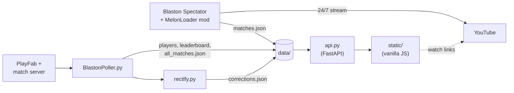

# Blastats

Match tracking and stats for [Blaston](https://www.resolutiongames.com/blaston), a VR dueling game. Blastats records ranked matches as they happen and turns them into leaderboards, player profiles, round by round replays and weapon meta stats.

The same client also runs a 24/7 YouTube livestream of the matches, and every recorded match on the site links to when it happened on the stream.

Live at [blastats.com](https://blastats.com). Stream at [YouTube](https://youtube.com/@CHANNEL).


## How it works



There are two sources of match data, and the API merges them.

- The mod runs inside the Blaston Spectator client, which is captured and streamed to YouTube around the clock. It joins the spectate queue, only watches matches where a player is above 1900 LP, and directs the camera so the stream follows the action. It also records everything the spectator view can see: loadouts, health at the end of each round, damage taken per weapon, a per hit damage timeline, grabs, ping and character portraits.
- The poller talks to the game's backend directly. It tracks the season leaderboards and player stats, and picks up every ranked match announcement, not just the ones the mod is spectating. It works out the winner by watching each player's lifetime rounds won counter change.
- The API pairs spectated matches with the poller's announcements (same players, within 3 minutes), applies result corrections, and serves the site.

## Components

| Path | What it is |
| --- | --- |
| `mod/` | C# MelonLoader mod using Harmony patches on the IL2CPP game. Records matches, directs the stream camera, keeps the spectate queue alive and restarts the client if it gets stuck. |
| `BlastonPoller.py` | Polls PlayFab for leaderboards and stats, and the match server for new matches. Runs the rectifier after each stats cycle. |
| `rectify.py` | Finds matches where the recorded winner is probably wrong, using ELO movement around the match. |
| `api.py` | FastAPI backend. Match merging, corrections, streaks, head to head, and weapon stats filtered by ELO range. |
| `static/` | Frontend. Plain ES modules, no build step or framework. |

## Running it

Needs Python 3.10 or newer.

```
pip install -r requirements.txt
```

The poller logs in with a PlayFab custom ID, read from an environment variable:

```
setx BLASTATS_CUSTOM_ID <id>
```

Then, from the project folder (open a new terminal after `setx`):

```
python BlastonPoller.py
python -m uvicorn api:app --port 8000
```

The site is at `http://localhost:8000`. Everything is stored in `data/`, which is created on first run and isn't part of the repo.

### Building the mod

1. Install [MelonLoader](https://melonwiki.xyz) into Blaston Spectator and launch it once so it generates `MelonLoader/Il2CppAssemblies`.
2. Set `GamePath` near the top of `mod/InternalMenuPatch/InternalMenuPatch.csproj` to your install folder.
3. Build, and copy `InternalMenuPatch.dll` into the game's `Mods` folder.
4. Point the mod at the project's `data/` folder in `UserData/MelonPreferences.cfg`, with the game closed:

   ```toml
   [BlastonTracker]
   DataDir = "C:/path/to/blastats/data"
   ```

## License

[MIT](LICENSE)