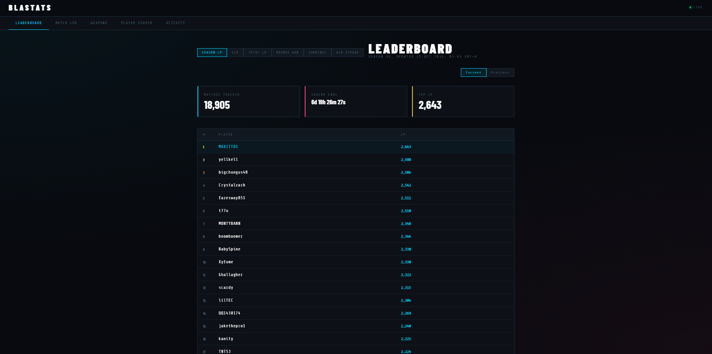
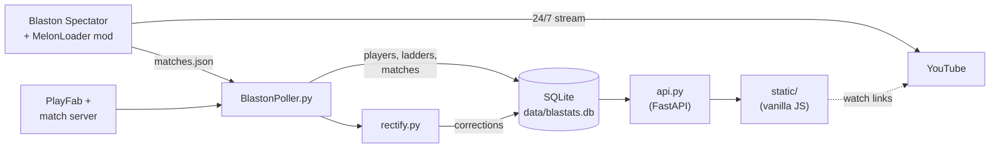
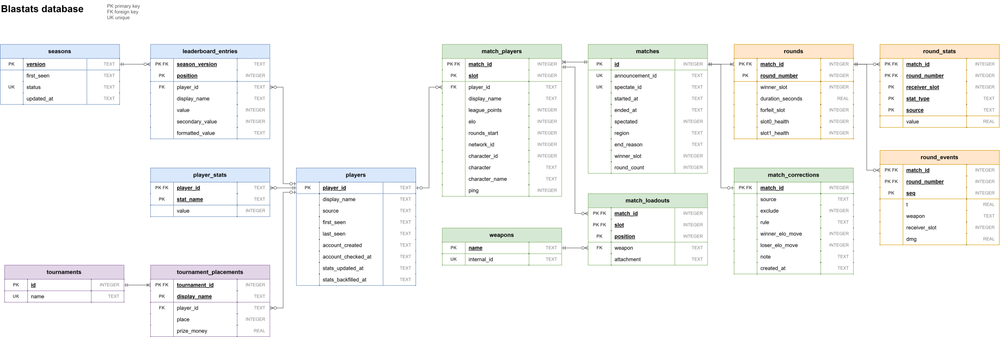

# Blastats

Match tracking and stats for [Blaston](https://www.resolutiongames.com/blaston), a VR dueling game. Blastats records ranked matches as they happen and turns them into leaderboards, player profiles, round by round replays and weapon meta stats.

The same client also runs a 24/7 YouTube livestream of the matches, and every recorded match on the site links to when it happened on the stream.

Live at [blastats.com](https://blastats.com). Stream at [YouTube](https://www.youtube.com/@xyfume/streams).



## How it works



There are two sources of match data, and the poller pairs them as they arrive.

- The mod runs inside the Blaston Spectator client, which is captured and streamed to YouTube around the clock. It spectates competitive queue, and records everything the spectator view can see: loadouts, health at the end of each round, damage taken per weapon, a per hit damage timeline, grabs, ping and character portraits.
- The poller talks to the game's backend directly. It tracks the season leaderboards and player stats, and picks up every ranked match announcement, not just the ones the mod is spectating. It works out the winner by watching each player's lifetime rounds won counter change.
- Whichever copy of a game arrives second is paired with the first (same players, within 3 minutes), so each game is stored once. The poller also picks up new spectated matches from the mod's `matches.json`.
- The API reads from the database, with result corrections applied by SQL views, and serves the site.

## Database

Everything is stored in one SQLite database, `data/blastats.db`, built from [`schema.sql`](schema.sql). Each game is a row in `matches`, with its players, loadouts, rounds, per round stats and damage events in their own tables. Corrections sit in a separate table and are applied by views, so recorded results are never edited.



This replaced a set of JSON files that the API re-read and re-merged whenever a match was added. With about 19,000 matches, the first profile load after a new match went from around 6 seconds to about 50 ms, or 0.6 seconds when the match was spectated and weapon stats need rebuilding.

## Components

| Path | What it is |
| --- | --- |
| `mod/` | C# MelonLoader mod using Harmony patches on the IL2CPP game. Records matches, directs the stream camera, keeps the spectate queue alive and restarts the client if it gets stuck. |
| `BlastonPoller.py` | Polls PlayFab for leaderboards and stats, the match server for new matches, and the mod's output for spectated matches. Saves everything to the database and runs the rectifier after each stats cycle. |
| `rectify.py` | Finds matches where the recorded winner is probably wrong, using ELO movement around the match. |
| `api.py` | FastAPI backend reading from the database. Streaks, head to head, and weapon stats filtered by ELO range. |
| `schema.sql` | Tables, indexes and the views the API reads through. |
| `db.py` | Opens the database with the right settings and creates it from the schema on first run. |
| `store.py` | Saves matches and pairs spectated copies with announcements. Shared by the poller and the import. |
| `import_json.py` | One off import of the old JSON files into the database. |
| `add_tournament.py` | Adds or updates tournament results. |
| `static/` | Frontend. Plain ES modules, no build step or framework. |

## Running it

Needs Python 3.10 or newer.

```
pip install -r requirements.txt
```

The poller logs in with a PlayFab custom ID, read from an environment variable:

```
setx BLASTATS_CUSTOM_ID <id>
```

If you're upgrading from the JSON version, load the old data once before starting anything. It won't overwrite an existing database unless given `--replace`.

```
python import_json.py
```

Then, from the project folder (open a new terminal after `setx`):

```
python BlastonPoller.py
python -m uvicorn api:app --port 8000
```

The site is at `http://localhost:8000`. Everything is stored in `data/`, which is created on first run and isn't part of the repo.

### Tournaments

Tournament results are added by hand from a JSON file holding one tournament or a list of them:

```json
{"name": "Halloween Cup 2026", "placement": [{"displayName": "Xyfume", "place": 1, "prizeMoney": 75}]}
```

```
python add_tournament.py cup.json
python add_tournament.py --list
python add_tournament.py --remove "Halloween Cup 2026"
```

A tournament with the same name is replaced, so a file can be edited and loaded again.

### Building the mod

1. Install [MelonLoader](https://melonwiki.xyz) into Blaston Spectator and launch it once so it generates `MelonLoader/Il2CppAssemblies`.
2. Set `GamePath` near the top of `mod/InternalMenuPatch/InternalMenuPatch.csproj` to your install folder.
3. Build, and copy `InternalMenuPatch.dll` into the game's `Mods` folder.
4. Point the mod at the project's `data/` folder in `UserData/MelonPreferences.cfg`, with the game closed:

   ```toml
   [BlastonTracker]
   DataDir = "C:/path/to/blastats/data"
   ```

## License

[MIT](LICENSE)
